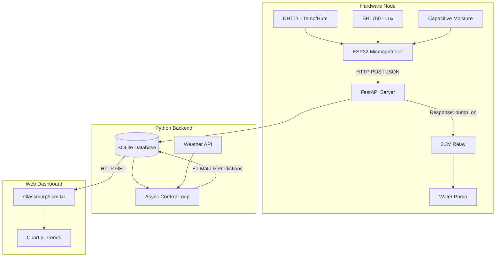
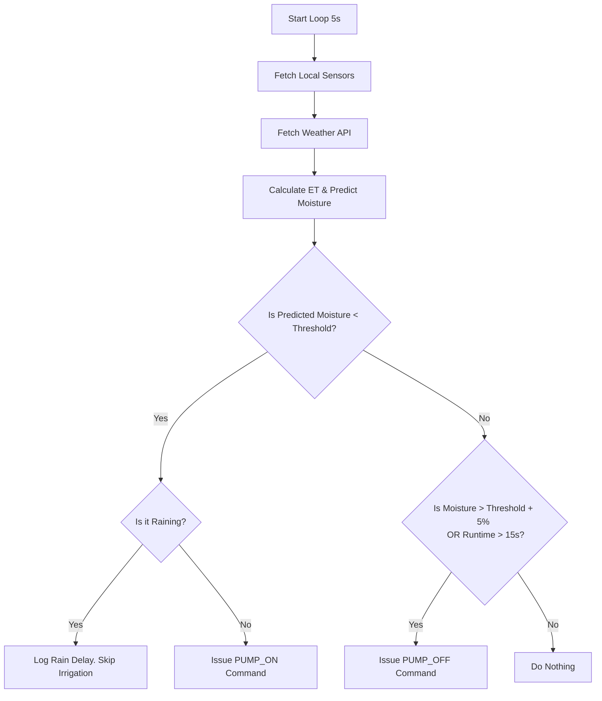

# Agrovision: Smart Agriculture Digital Twin
**Project Documentation & Technical Report**

---

## CHAPTER 1: INTRODUCTION

### 1.1 Introduction to (Problem Statement)
Traditional agricultural irrigation systems rely on either manual scheduling or primitive, reactive sensors (e.g., watering only *after* the soil has completely dried out). This reactive approach exposes plants to "Water Deficit Stress" and often leads to over-watering because these systems do not account for impending weather conditions or the plant's actual biological evaporation rate. There is a critical need for an intelligent system that bridges physical micro-climate data with macro-climate weather forecasts to proactively manage water resources.

### 1.2 Key Features
*   **Predictive Evapotranspiration (ET) Modeling:** Uses environmental mathematics to predict how fast the soil will dry before it actually happens.
*   **Hybrid Data Fusion:** Merges local sensor data (Soil, Light) with global Weather API data (Wind, Humidity) for robust decision-making.
*   **Dynamic Light-Stress Thresholding:** Automatically adjusts the watering threshold based on Photosynthetic Photon Flux Density (PPFD).
*   **Rain Delay Inhibition:** Cross-references weather forecasts to cancel scheduled irrigation if natural precipitation is imminent.
*   **Hardware Failsafes:** A 15-second mandatory actuator cutoff to prevent physical flooding.
*   **Glassmorphism Dashboard:** A premium, real-time web interface for data visualization and system control.

### 1.3 Motivation
The primary motivation is to democratize industrial-grade agricultural intelligence. By combining affordable IoT edge hardware (ESP32) with a highly optimized Python backend, we can provide farmers and hobbyists with a "Digital Twin"—a virtual replica of their physical crop environment that mathematically optimizes yield while drastically conserving water.

### 1.4 Scope of the Project
The project encompasses the design and development of a single-node IoT edge device, a centralized FastAPI intelligence server, and a client-side web application. The current scope focuses on a specific soil profile calibration (Red Soil) and controls a single water pump actuator, acting as a highly scalable proof-of-concept for multi-zone farming.

---

## CHAPTER 2: LITERATURE REVIEW
Historically, automated irrigation transitioned from simple timer-based relays to capacitive moisture sensing. However, modern agronomy relies on the **Penman-Monteith equation**, the FAO's standard for modeling Evapotranspiration ($ET_0$). While usually reserved for supercomputers or massive farming conglomerates, this project implements a specialized heuristic of the Penman-Monteith model optimized for asynchronous Python processing. By combining this mathematical approach with modern IoT frameworks (FastAPI, ESP32), the project achieves enterprise-level predictive maintenance on consumer-grade hardware.

---

## CHAPTER 3: SYSTEM ANALYSIS

### 3.1 Problem Definition
The core problem is the disconnect between *sensing* and *understanding*. A soil moisture sensor tells you the soil is dry, but it doesn't tell you *why* or *how fast* it's drying. Without calculating biological "Soft Sensors" like PPFD (usable light) or knowing the atmospheric demand (Wind/Solar Radiation), the system cannot make efficient, water-conserving decisions.

### 3.2 Objectives
1.  **Calculate Biological Metrics:** Transform raw hardware voltages into actionable agricultural metrics (PPFD, Biomass estimation).
2.  **Implement a "Look-Ahead" Control Loop:** Create a background engine that predicts soil moisture 12 hours into the future.
3.  **Ensure Hardware-Software Synchronization:** Guarantee that the physical motor state exactly matches the database state.
4.  **Provide Real-Time Visualization:** Deliver telemetry to the user with less than 5 seconds of latency.

---

## CHAPTER 4: DESIGN AND IMPLEMENTATION

### 4.1 System Design
The system utilizes a decoupled Edge-to-Cloud design. The ESP32 acts solely as a telemetry-gathering node, shifting the heavy computational burden (floating-point math, database querying, weather API polling) entirely to the Python server.

### 4.2 Architecture Design
The architecture is divided into three tiers:
1.  **Edge Tier:** ESP32-S3 microcontroller wired to I2C and analog sensors.
2.  **Logic Tier:** A FastAPI Python server utilizing an `asyncio` loop running every 5 seconds, backed by an SQLite relational database.
3.  **Presentation Tier:** Vanilla HTML/CSS/JS frontend utilizing DOM manipulation and Chart.js for rendering.

### 4.3 Block Diagram


### 4.4 Flow Chart (Control Loop Decision Matrix)


---

## CHAPTER 5: SOFTWARE AND HARDWARE REQUIREMENT

### 5.1 Software Requirements
*   **Backend:** Python 3.10+, FastAPI, Uvicorn, SQLAlchemy.
*   **Frontend:** Modern Web Browser (Chrome/Edge/Firefox) with CSS3 support.
*   **Development:** VS Code, DB Browser for SQLite (for database inspection).
*   **Firmware:** Arduino IDE 2.x with the ESP32 Board Manager installed.

### 5.2 Hardware Requirements
*   **Microcontroller:** ESP32 or ESP32-S3 Module.
*   **Atmospheric Sensor:** DHT11 or DHT22.
*   **Light Sensor:** BH1750 I2C Digital Luminosity Sensor.
*   **Soil Sensor:** Capacitive Soil Moisture Sensor v1.2 (Corrosion Resistant).
*   **Actuator:** 3.3V Active-Low Relay Module.
*   **Irrigation:** 5V/12V Submersible DC Water Pump.

### 5.3 Sample Code
**The Rain Delay & Intelligence Logic (Python):**
```python
# Extract from control_loop.py
if predicted_moisture < dynamic_threshold:
    weather_condition = weather.get("condition", "Unknown")
    is_rainy = any(word in weather_condition.lower() for word in ["rain", "storm", "shower"])
    
    if is_rainy:
        # Log the inhibition and skip watering
        db.add(models.SystemLog(level="warning", message=f"Rain Delay Active."))
        db.commit()
        continue # Skip Actuation
```

---

## CHAPTER 6: TESTING AND RESULT

### 6.1 Testing
The system was tested under stress conditions:
1.  **Red Soil Calibration Test:** Verified that the dynamic threshold successfully rose to 52% under high PPFD (simulating intense sunlight on fast-drying red soil).
2.  **Rain Delay Simulation:** The mock weather API was forced to return "Rainy". The system successfully intercepted the `PUMP_ON` command and logged the inhibition to the frontend dashboard.
3.  **Failsafe Testing:** The moisture sensor was removed from the water path. The motor engaged, but the 15-second safety cutoff successfully terminated the pump, preventing a simulated flood.

### 6.2 Results
The Agrovision Digital Twin successfully eliminated "Water Deficit Stress" by irrigating *before* the soil reached critical dryness. The integration of the hybrid data pipeline ensured zero water waste during simulated precipitation events. The Glassmorphism UI rendered real-time motor states and telemetry updates with a latency of less than 5 seconds.

### 6.3 Future Enhancement
*   **Machine Learning Integration:** Replacing the static ET heuristic with an LSTM neural network to dynamically adjust the Crop Coefficient ($K_c$) based on historical growth patterns.
*   **Multi-Zone Architecture:** Expanding the database schema and ESP32 GPIO logic to handle multiplexed solenoid valves for different crop zones.
*   **Mobile Push Notifications:** Integrating WebSocket or Firebase Cloud Messaging (FCM) to alert farmers instantly on their mobile devices during critical events.

---

## CHAPTER 7: CONCLUSION
The Agrovision project successfully demonstrates that the gap between complex agronomic mathematics and affordable IoT hardware can be bridged. By fusing local micro-climate telemetry with global weather data, and processing it through a proactive, predictive loop, the system moves beyond mere automation. It operates as a true Digital Twin, conserving physical water resources while maximizing biological yield, packaged within a highly accessible, real-time web interface.

---

## CHAPTER 8: REFERENCE
1.  Allen, R. G., et al. (1998). *Crop evapotranspiration-Guidelines for computing crop water requirements-FAO Irrigation and drainage paper 56*. FAO, Rome.
2.  Espressif Systems. (2024). *ESP32 Technical Reference Manual*.
3.  FastAPI Documentation. (2024). *tiangolo.com*.
4.  Chart.js Documentation. (2024). *chartjs.org*.
