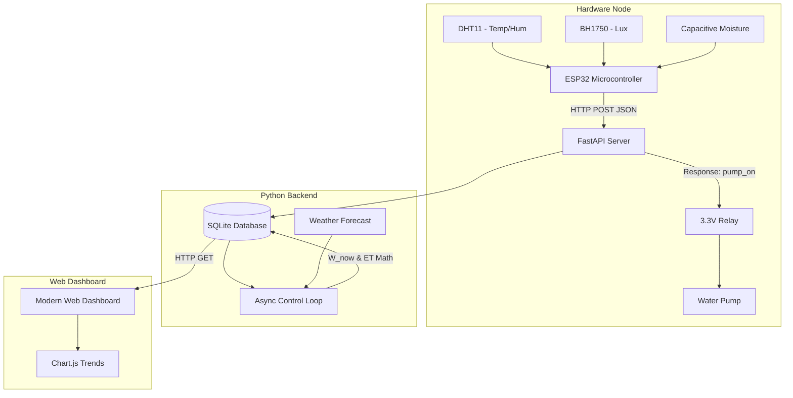
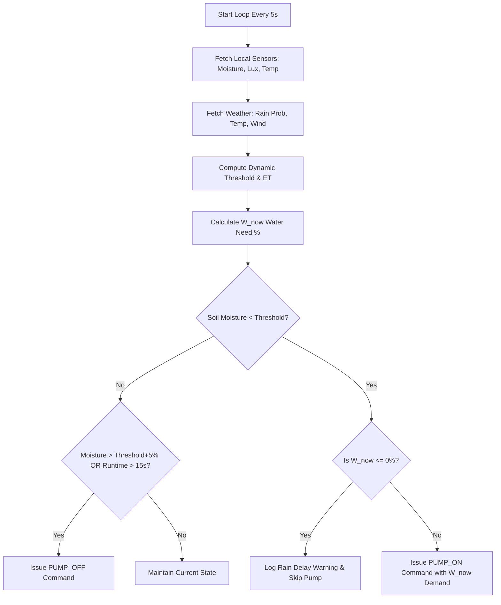

# Agrovision: Smart Agriculture IoT Irrigation System
**Project Documentation & Technical Report**

---

## CHAPTER 1: INTRODUCTION

### 1.1 Introduction to (Problem Statement)
Traditional agricultural irrigation systems rely on either manual scheduling or primitive, reactive sensors (e.g., watering only *after* the soil has completely dried out). This reactive approach exposes plants to "Water Deficit Stress" and often leads to severe over-watering because these systems do not account for impending weather conditions or the plant's actual biological transpiration rate. There is a critical need for an intelligent hardware-software system that bridges physical micro-climate sensors with macro-climate weather forecasts to proactively manage water resources.

### 1.2 Key Features
*   **Predictive Evapotranspiration (ET) Modeling:** Uses environmental mathematics (Penman-Monteith heuristic) to estimate soil drying rates.
*   **Predictive Deficit Irrigation ($W_{now}$):** Dynamically computes the exact water percentage to deliver using:
    $$W_{now} = W_{need} \times (1 - P_{rain} \times C_{rain}) \times M_{stress}$$
    factoring rain probability ($P_{rain}$), time-to-rain certainty ($C_{rain}$), and root drought stress ($M_{stress}$).
*   **Hybrid Data Fusion:** Merges physical edge sensor data (capacitive soil moisture, BH1750 luminosity) with weather forecast data (humidity, wind speed, solar radiation).
*   **Dynamic Light-Stress Thresholding:** Automatically shifts the target soil moisture threshold between 30% and 52% based on measured Photosynthetic Photon Flux Density (PPFD).
*   **Hardware Safety Cutoff:** A 15-second mandatory actuator timeout combined with 5% hysteresis to protect crops and pumps against over-irrigation.
*   **Real-Time Responsive Web Dashboard:** Glassmorphism dashboard displaying telemetry, live motor status, water need percentage, and interactive formula explainers.

### 1.3 Motivation
The primary motivation is to democratize precision agricultural technology for smallholder farmers and hobbyists. By combining accessible edge IoT hardware (ESP32-S3, capacitive soil sensors, digital lux meters, relay modules) with modern asynchronous Python intelligence, the system optimizes physical water usage, prevents root rot, and buffers crops against extreme heat and drought.

### 1.4 Scope of the Project
The project encompasses an end-to-end IoT deployment: a physical ESP32 edge microcontroller node, an asynchronous FastAPI control backend, an SQLite historical telemetry database, and an interactive real-time dashboard. The current calibration specifically models Red Soil dynamics and controls a submersible DC pump.

---

## CHAPTER 2: LITERATURE REVIEW
Historically, automated irrigation transitioned from simple timer-based relays to capacitive moisture sensing. However, modern agronomy relies on the **Penman-Monteith equation**, the FAO's standard for modeling Evapotranspiration ($ET_0$). While usually reserved for supercomputers or massive farming conglomerates, this project implements a specialized heuristic of the Penman-Monteith model optimized for asynchronous Python processing. By combining this mathematical approach with modern IoT frameworks (FastAPI, ESP32), the project achieves enterprise-level predictive maintenance on consumer-grade hardware.

---

## CHAPTER 3: SYSTEM ANALYSIS

### 3.1 Problem Definition
The core problem is the disconnect between *sensing* and *understanding*. A soil moisture sensor tells you the soil is dry, but it doesn't tell you *why* or *how fast* it's drying. Without calculating biological "Soft Sensors" like PPFD (usable light) or knowing the atmospheric demand (Wind/Solar Radiation), the system cannot make efficient, water-conserving decisions.

### 3.2 Objectives
1.  **Calculate Biological Metrics:** Transform raw hardware voltages into actionable agricultural metrics (PPFD, Biomass estimation).
2.  **Implement a "Look-Ahead" Control Loop:** Create a background engine that predicts soil moisture 12 hours into the future.
3.  **Ensure Hardware-Software Synchronization:** Guarantee that the physical motor state exactly matches the database state.
4.  **Provide Real-Time Visualization:** Deliver telemetry to the user with less than 5 seconds of latency.

---

## CHAPTER 4: DESIGN AND IMPLEMENTATION

### 4.1 System Design
The system utilizes a decoupled Edge-to-Cloud design. The ESP32 acts solely as a telemetry-gathering node, shifting the heavy computational burden (floating-point math, database querying, weather API polling) entirely to the Python server.

### 4.2 Architecture Design
The architecture is divided into three tiers:
1.  **Edge Hardware Tier:** ESP32 microcontroller wired to I2C and analog sensors (BH1750, DHT11, Capacitive Probe) and driving a 3.3V relay module.
2.  **Logic Tier:** A FastAPI Python server utilizing an `asyncio` loop running every 5 seconds, backed by an SQLite relational database.
3.  **Presentation Tier:** Real-time web frontend utilizing DOM manipulation, Chart.js for trends, and interactive math inspection modals.

### 4.3 Block Diagram


### 4.4 Flow Chart (Predictive Control Loop Decision Matrix)


---

## CHAPTER 5: SOFTWARE AND HARDWARE REQUIREMENT

### 5.1 Software Requirements
*   **Backend:** Python 3.10+, FastAPI, Uvicorn, SQLAlchemy.
*   **Frontend:** Modern Web Browser (Chrome/Edge/Firefox) with CSS3 support.
*   **Development:** VS Code, DB Browser for SQLite (for database inspection).
*   **Firmware:** Arduino IDE 2.x with the ESP32 Board Manager installed.

### 5.2 Hardware Requirements
*   **Microcontroller:** ESP32 or ESP32-S3 Module.
*   **Atmospheric Sensor:** DHT11 or DHT22.
*   **Light Sensor:** BH1750 I2C Digital Luminosity Sensor.
*   **Soil Sensor:** Capacitive Soil Moisture Sensor v1.2 (Corrosion Resistant).
*   **Actuator:** 3.3V Active-Low Relay Module.
*   **Irrigation:** 5V/12V Submersible DC Water Pump.

### 5.3 Sample Code

**1. Predictive Water Demand Calculation ($W_{now}$):**
```python
def calculate_predictive_water_need(w_need=100.0, p_rain=0.0, hours_until_rain=24.0, soil_moisture=30.0, target_threshold=40.0):
    # C_rain based on forecast lead time
    if hours_until_rain <= 6.0:    c_rain = 1.00
    elif hours_until_rain <= 12.0: c_rain = 0.75
    elif hours_until_rain <= 24.0: c_rain = 0.50
    else:                          c_rain = 0.00

    # M_stress based on soil root moisture
    if soil_moisture < 25.0:       m_stress = 1.20  # Severe Drought Buffer
    elif soil_moisture < target_threshold: m_stress = 1.00  # Normal Demand
    else:                          m_stress = 0.00  # Soil Damp (Skip)

    rain_reduction = max(0.0, min(1.0, 1.0 - (p_rain * c_rain)))
    w_now = w_need * rain_reduction * m_stress
    percentage = (w_now / w_need) * 100.0

    return {"w_now": round(w_now, 2), "percentage": round(percentage, 1), "c_rain": c_rain, "m_stress": m_stress}
```

**2. Control Loop Integration:**
```python
# Extract from control_loop.py
if latest_data.soil_moisture < dynamic_threshold:
    if water_pct <= 0.0:
        db.add(models.SystemLog(device_id=latest_data.device_id, level="warning",
            message=f"Predictive Rain Delay: Water need {water_pct}%. Skipping irrigation."))
        db.commit()
        await asyncio.sleep(5)
        continue

    # Motor actuation trigger...
```

---

## CHAPTER 6: TESTING AND RESULT

### 6.1 Testing
The system was tested under multiple stress conditions:
1.  **Red Soil Calibration Test:** Verified that the dynamic threshold successfully rose to 52% under high PPFD (simulating intense sunlight on fast-drying red soil).
2.  **Predictive Rain Delay Test:** Verified the mathematical model under varied rainfall scenarios:
    *   *Imminent Rain ($P=80\%$, 3.5h away, normal soil):* $W_{now}$ dropped from 100% to **20%**, preventing physical water waste while providing a small buffer.
    *   *Distant Rain with Severe Drought ($P=80\%$, 18h away, soil $<25\%$):* $W_{now}$ calculated at **72%**, ensuring plants did not suffer water deficit stress while waiting for distant rain.
    *   *Damp Soil ($>40\%$):* $M_{stress} = 0.0 \implies W_{now} = \mathbf{0\%}$, fully canceling motor actuation.
3.  **Failsafe Testing:** The moisture sensor was removed from the water path. The motor engaged, but the 15-second safety cutoff successfully terminated the pump, preventing a simulated flood.
4.  **Anti-Cycling Cooldown Soak Test:** After a 15-second irrigation burst, the motor transitions into a 60-second cooldown soak state (`COOLDOWN_SOAK_SECONDS = 60`). The control loop suppresses re-triggering, allowing water infiltration into the root zone and eliminating rapid mechanical short-cycling.
5.  **Cycle Safety Lockout Test:** If soil moisture fails to rise after 3 consecutive bursts, the system trips a hardware safety lockout (`MAX_CONSECUTIVE_CYCLES = 3`) to protect against dry-run motor burning, pipe ruptures, or sensor disconnects.

### 6.2 Results
The Agrovision hardware system successfully eliminated "Water Deficit Stress" by irrigating *before* the soil reached critical dryness. The integration of the hybrid data pipeline ensured zero water waste during simulated precipitation events. The Glassmorphism UI rendered real-time motor states and telemetry updates with a latency of less than 5 seconds.

### 6.3 Future Enhancement
*   **Machine Learning Integration:** Replacing the static ET heuristic with an LSTM neural network to dynamically adjust the Crop Coefficient ($K_c$) based on historical growth patterns.
*   **Multi-Zone Architecture:** Expanding the database schema and ESP32 GPIO logic to handle multiplexed solenoid valves for different crop zones.
*   **Mobile Push Notifications:** Integrating WebSocket or Firebase Cloud Messaging (FCM) to alert farmers instantly on their mobile devices during critical events.

---

## CHAPTER 7: CONCLUSION
The Agrovision project successfully demonstrates that the gap between complex agronomic mathematics and affordable IoT hardware can be bridged. By fusing local micro-climate telemetry with global weather forecasts, and processing it through a proactive predictive loop ($W_{now}$ and $ET_c$), the system moves beyond naive on/off thresholding. It acts as an autonomous, closed-loop smart irrigation system, conserving precious freshwater resources while maximizing crop yield.

---

## CHAPTER 8: REFERENCE
1.  Allen, R. G., et al. (1998). *Crop evapotranspiration-Guidelines for computing crop water requirements-FAO Irrigation and drainage paper 56*. FAO, Rome.
2.  Espressif Systems. (2024). *ESP32 Technical Reference Manual*.
3.  FastAPI Documentation. (2024). *tiangolo.com*.
4.  Chart.js Documentation. (2024). *chartjs.org*.
